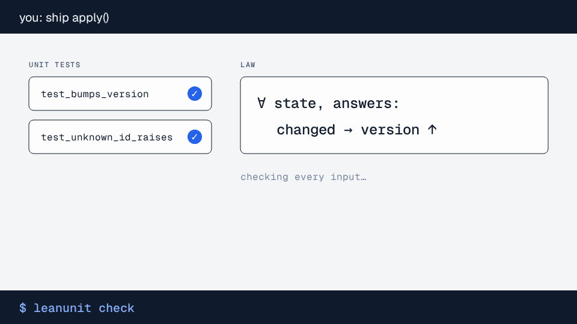
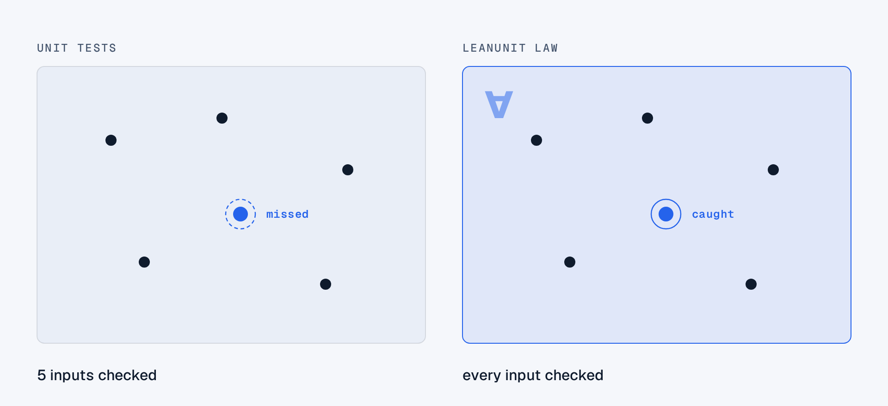
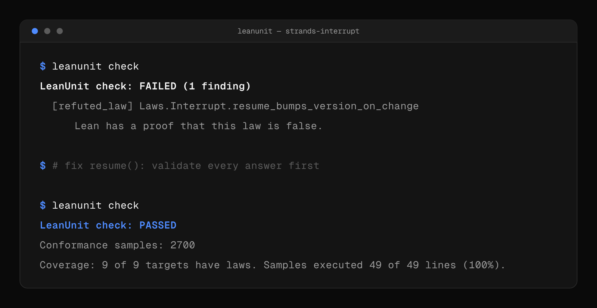

<h1 align="center">LeanUnit</h1>

<p align="center">Agent-first unit tests. Your agent proves laws about your code in Lean.</p>

<p align="center"></p>

LeanUnit replaces hand-written unit tests with Lean proofs that your agent writes.
You approve the laws. A lock file records each approved law, and the build fails when a change breaks a law.
Your coding agent, a workspace agent, or a CI job can then repair the proofs with the same commands.

## How it works

You approve **laws**. A law is a Lean statement that your code must obey, for example "an inactive state never saves an invocation-scoped approval".
Your agent writes the rest:

- a **model**, which is a copy of the logic of your code in Lean
- **generators**, which make random inputs for the model
- **proofs**, which the Lean kernel verifies

A model is not your code. Thus, LeanUnit runs the model and your real code on the same random inputs and compares the outputs.
LeanUnit also makes sure that the samples execute each line of the code.
This comparison is the conformance step. It ties the proofs to the code that you ship.

## LeanUnit and unit tests

Unit tests verify the inputs that you select. A LeanUnit law states a property for each input.

<p align="center"></p>

This function has a bug:

```python
def apply(state, answers):
    for id, value in answers:
        if id not in state.items:
            raise KeyError(id)
        state.items[id] = value
    state.version += 1
```

These unit tests pass:

```python
def test_bumps_version():
    s = State(items={"a": None}, version=0)
    apply(s, [("a", "yes")])
    assert s.version == 1

def test_unknown_id_raises():
    s = State(items={"a": None}, version=0)
    with pytest.raises(KeyError):
        apply(s, [("missing", "x")])
```

But the input `[("a", "yes"), ("missing", "x")]` writes `"yes"`, then raises `KeyError`, and does not increment the version.
No test uses this input, so no test fails.

In LeanUnit, you approve one law:

```lean
@[law] def bump_on_change : Prop :=
  ∀ s answers, (apply s answers).self ≠ s → (apply s answers).self.version > s.version
```

No proof of this law is possible. An agent proves that the law is false with the input above, and the Lean kernel verifies that refutation.
`leanunit check` then reports `refuted_law`.
The corrected code validates all the answers before it writes. For that code, the law has a proof for each state and each list of answers.

| | Unit tests | LeanUnit |
|---|---|---|
| The claim | The output is correct for the selected inputs. | The law is true for each input. |
| The inputs | You select them. | A failure shows an input that you did not select. |
| The bug above | Not found | Found, with the input that causes it |
| An agent changes the check to make it pass | The tests pass, and nobody sees the change. | `leanunit check` fails until you approve the changed law. |
| The link to the code | Direct | LeanUnit compares the model with the code on 2,400 random inputs. |

The proof is about the Lean model. Conformance ties the model to your code only on the sampled inputs.

## Requirements

- Lean 4 through [elan](https://github.com/leanprover/elan). The Lean projects pin `leanprover/lean4:v4.36.0`.
- Python 3.11 or later for LeanUnit. LeanUnit has no run-time dependencies.
- For Python code, an interpreter that can import your code. LeanUnit uses its own interpreter if you do not set one.
- For TypeScript and JavaScript code, Node.js 22 or later. `leanunit new` also uses the `typescript` package of your project.

LeanUnit runs the Lean sampler with `lean --run`, so it does not need a C compiler.

## Languages

LeanUnit supports Python, TypeScript, and JavaScript. The table name in `leanunit.toml` selects the language.

| Language | Table | Default runtime | Target form |
|---|---|---|---|
| Python | `[python]` | The interpreter of LeanUnit | `package.module:Class` or `package.module:function` |
| TypeScript | `[typescript]` | `node --experimental-strip-types` | `path/to/module:Class` or `path/to/module:function` |
| JavaScript | `[javascript]` | `node` | `path/to/module:Class` or `path/to/module:function` |

For TypeScript and JavaScript, the module path is relative to `source_root`, without the file extension.
To use another runtime, set `runtime` in the table, for example `runtime = ["node", "--import", "tsx"]`.
Each language has a small runner with the same JSON protocol, so the Lean side does not change between languages.

## Install

LeanUnit is not on PyPI yet. Install it from a clone:

```bash
uv tool install --editable /path/to/leanunit
```

## Quick start

1. Make the files: `leanunit init --source-root src --cover mypackage.module:MyClass`. For TypeScript, add `--language typescript`.
2. Tell your agent to read `LEANUNIT.md` and to cover `mypackage.module:MyClass`.
3. The agent runs `leanunit new`, completes the models, writes draft laws, and proves them. It stops when only approvals are pending.
4. Read each draft law in `lean/Laws/`, and approve the laws that you agree with: `leanunit approve <law>`.
5. Add `leanunit check` to your build or CI.

To let LeanUnit start an agent for you, set a command in the `[agent]` table of `leanunit.toml`, and run `leanunit fix`.

## Project layout

| Path | Owner | Contents |
|---|---|---|
| `leanunit.toml` | Team | The code to cover, the Lean project, the sample count, and the agent command. |
| `leanunit.lock` | You | The approved laws. Only `leanunit approve` writes this file. |
| `lean/Laws/` | You | The laws. An agent can write drafts. |
| `lean/Model/` | Agent | The model functions, each with `@[mirror "module:Qualname"]`. |
| `lean/Gen/` | Agent | The `Sample` instances for the model types. |
| `lean/Proofs/` | Agent | One theorem for each law, or a refutation with `¬`. |
| `LEANUNIT.md` | LeanUnit | The guide for agents. `leanunit guide --write` updates it. |
| `AGENTS.md` | Team | LeanUnit adds one pointer to `LEANUNIT.md`, and adds the same pointer to `CLAUDE.md` if that file exists. |

## Commands

| Command | What it does |
|---|---|
| `leanunit check` | Verifies the laws, the proofs, the conformance, and the coverage. Add `--json` for a report that a program can read. |
| `leanunit coverage` | Shows each covered function, its mirror, its laws, and the lines that the samples executed. |
| `leanunit new <module:Qualname>` | Writes Lean types, `Sample` generators, and a stub mirror for each function, from the types in the code. |
| `leanunit approve <law>...` | Records the current statement of each law in the lock. Short names are permitted. |
| `leanunit approve --all` | Approves all laws, and removes laws that are gone. |
| `leanunit fix` | Starts the configured agent when the check fails. Then it restores the protected files and checks again. |
| `leanunit guide` | Shows the guide. `leanunit guide --write` writes `LEANUNIT.md` and the pointers. |
| `leanunit init` | Makes `leanunit.toml`, an empty lock, the Lean project, and `LEANUNIT.md`. |

`leanunit check` and `leanunit fix` use these exit codes:

| Code | Meaning |
|---|---|
| 0 | The check passed. |
| 1 | The check found work for an agent or a developer. |
| 2 | The command or the configuration is wrong. |
| 3 | Only your approval can clear the findings. |

## What the check verifies

`leanunit check` passes only when all these conditions are true:

- Each law is approved, and its statement agrees with the lock.
- Each law has a proof, and no law has a refutation.
- No proof uses `sorry` or an axiom other than `propext`, `Classical.choice`, and `Quot.sound`.
- No definition that a law or a mirror uses has `implemented_by`, `extern`, `unsafe`, or `partial`.
- Each mirror gives the same JSON output as its code function on all samples.
- The samples execute each line of each mirrored code function.
- Each function in the `cover` list has a mirror, and a law uses each mirror.

## The lock file

The lock records a hash for each law.
The hash covers the law and each helper definition that the law uses.
A change to a mirrored function does not change the hash, because conformance ties that function to the real code.
Thus, an agent can repair a proof without approval, but it cannot weaken a law without approval.

## Write a model

A model function mirrors one function or method of the code.
For a method, the first argument is the object, and the result is a `LeanUnit.Outcome`:

```lean
@[mirror "strands.interrupt:_InterruptState.activate"]
def activate (s : State) : Outcome State Unit :=
  .ok { s with activated := true, _version := s._version + 1 } ()
```

- `Outcome.ok self ret` is a normal return. `Outcome.raise "KeyError" self` is an exception.
- `LeanUnit.Val` holds any JSON value, for example a field of type `Any`.
- `LeanUnit.Dict α` is a Python `dict[str, T]` or a TypeScript `Record<string, T>`.
- The JSON form of each model type must agree with the value in the code. Use the field names of the code.

## Example

`examples/strands-interrupt` covers the `_InterruptState` class of the Strands Agents SDK.
It has 10 laws. LeanUnit proves 9 of them, and it refutes 1 of them.
The refuted law shows a real bug: `resume` can change the state without an increase of the version.
Refer to `examples/strands-interrupt/README.md`.

After the bug fix in `docs/demo.md`, the agent updates the model, and all 14 laws pass:

<p align="center"></p>

## Limits

- LeanUnit supports pure logic only. It does not support I/O, threads, floats, or callbacks.
- In Python, LeanUnit mirrors plain functions and the methods of dataclasses. It does not mirror async functions, classmethods, staticmethods, properties, or dunder methods.
- In TypeScript and JavaScript, LeanUnit mirrors exported functions and the methods of exported classes. It waits for the result of an async function. It does not mirror static methods, getters, setters, or functions with rest parameters.
- TypeScript runs through the type stripping of Node.js. For syntax that type stripping does not support, such as `enum`, set another `runtime`.
- Conformance is random testing. A model can differ from the code on inputs that the samples do not include.
- LeanUnit does not shrink a failure. It shows the smallest failure that it found.

Refer to `docs/design.md` for the full design.

## License

LeanUnit has the Apache License 2.0. Refer to `LICENSE`.
The copy of `interrupt.py` in the example also has the Apache License 2.0, with its own `LICENSE` and `NOTICE` files.
